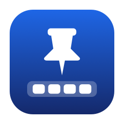

<p></p>

# DockPin

把 macOS 底部 Dock 固定在你选的屏幕。

[English](README.md) · [下载安装包](https://github.com/RichardLoZC/DockPin/releases/latest) · [MIT 许可证](LICENSE)

DockPin 是一个免费、本地运行的菜单栏小工具，用来防止 Dock 意外跑到副屏。它保留多屏独立桌面，继续使用系统原生 Dock，无需订阅、账户或联网。

## 功能

- 固定到主显示器，或指定的已连接屏幕。
- 按住 **Option** 临时允许 Dock 跨屏。
- 一键暂停，退出后立即解除拦截。
- 按屏幕 UUID 记忆选择；首选屏断开后暂用主屏。
- 手动归位按钮；检测到用户移动或点击鼠标就中止。
- 可选登录时启动，默认关闭。
- 区分“已固定”“等待 Dock 归位”和“等待辅助功能授权”。

## 系统要求

- Apple Silicon Mac，macOS 14 或更新版本。
- 至少两块屏幕，Dock 位于**底部**。
- 开启“系统设置 → 桌面与程序坞 → 调度中心 → **显示器具有单独的空间**”。
- 授予 DockPin **辅助功能**权限，无需屏幕录制权限。

v1.0.0 界面为简体中文。已在 macOS 27.0.1、内置屏与 Nextend 虚拟副屏组合上验证锁定机制；其他硬件和系统版本仍需验证。

## 安装与使用

1. 从 [Releases](https://github.com/RichardLoZC/DockPin/releases/latest) 下载 `DockPin-1.0.0-macos-arm64.zip`。
2. 解压，将 `DockPin.app` 放入 `/Applications` 或 `~/Applications`。
3. 打开应用，在“系统设置 → 隐私与安全性 → 辅助功能”中允许 DockPin。
4. 点击菜单栏图钉，在“固定到屏幕”中选择目标。默认跟随系统主显示器。
5. 若提示“等待 Dock 归位”，在目标屏底边向下推动鼠标，或点击“现在将 Dock 移回目标屏”。显示“已固定：屏幕名称”后，表示 Dock 已在目标屏且拦截已运行。

发布包采用**临时签名，未公证**。首次打开时，macOS 可能要求在“隐私与安全性”中批准运行；也可以从源码构建。更新本地构建后，系统可能要求重新授予辅助功能权限。

按住 Option 可临时放行。松开后若 Dock 留在另一屏，需要再归位一次。取消“固定 Dock”或退出程序即可恢复正常。“登录时启动”可在菜单中开启，若系统要求批准，请在“通用 → 登录项与扩展”中完成。

## 工作原理与限制

程序通过公开的 Quartz 会话级事件过滤接口，拦截非目标屏底部 **4 个桌面点**内的鼠标移动和拖动，阻止触边手势把 Dock 召到该屏。点击、滚轮和键盘事件不在过滤范围内，所有处理均在本机完成。

- 这条窄区域内的悬停、拖动反馈或触发角可能受影响，按住 Option 可以放行。
- 只支持底部 Dock；改放侧边时自动暂停拦截。
- 上下排列时，目标屏底边需要露出至少 **8 个桌面点宽**的区域。完全被下方屏幕挡住时，请在系统设置中错开排列。
- 归位按钮最多尝试约 1.8 秒，会短暂移动鼠标，完成或超时后还原。检测到用户移动或点击鼠标就中止。后台不会自动移动鼠标。
- 锁定依赖程序持续运行。重启 Dock、登录或显示器变化时，系统仍可能重新选择 Dock 所在屏；此时会提示等待归位。
- 只有一块屏幕，或“显示器具有单独的空间”关闭时，程序停止过滤。休眠及用户会话切换时暂停，恢复后重新检查环境。
- 屏幕 UUID 由 macOS 提供；重复或不稳定的 UUID 可能需要手动重新选屏。
- 全屏 App、调度中心、触发角及未来 macOS 版本的行为可能不同。具体测试范围见[验证记录](docs/VALIDATION.md)。

## 构建与测试

安装 Apple Command Line Tools 或 Xcode，SDK 需支持 macOS 14 及以上。无需包管理器或第三方运行时。

```sh
git clone https://github.com/RichardLoZC/DockPin.git
cd DockPin
./scripts/build.sh
./scripts/test.sh
```

产物为 `outputs/DockPin.app`。测试包括 34 项几何与鼠标接管检查、构建、签名和诊断读取。若测试进程已有辅助功能权限，还会使用空策略验证真实事件过滤器的启停，所有输入均放行。测试不会移动鼠标或断开扩展屏。

生成发布 ZIP 和 SHA-256 校验文件：

```sh
./scripts/package.sh
```

读取本机诊断：

```sh
outputs/DockPin.app/Contents/MacOS/DockPin --diagnose
```

诊断包含屏幕名称、UUID、坐标及权限状态，分享前请检查内容。终端启动的进程可能继承终端权限，不能据此判断独立 GUI 应用是否已获授权。

## 许可证与致谢

本项目采用 [MIT 许可证](LICENSE)。事件过滤思路和 Dock 窗口识别参考了同为 MIT 许可的 [Lockdock](https://github.com/mishamyrt/lockdock)，其版权声明保留在 [THIRD_PARTY_NOTICES.md](THIRD_PARTY_NOTICES.md) 中。

DockPin 独立于商业 DockLock 应用，未使用其代码或资源。
